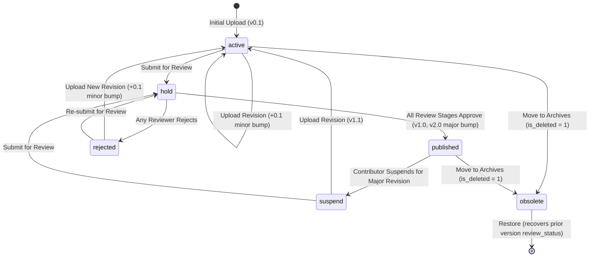

# EDMS — Engineering Document Management System

A lightweight, high-performance Engineering Document Management System built with PHP 8+, MySQL (InnoDB + Recursive CTEs), and vanilla JavaScript/CSS. Designed for zero-build-step deployment on XAMPP or standard Apache/PHP stacks.

---

## 1. Quick Start for Contributors

1. **Database Setup**:
   - Create a MySQL database named `edms_db` (`utf8mb4_unicode_ci`).
   - Import [`config/schema.sql`](config/schema.sql) to create all tables, foreign keys, and initial seed data.
   - Verify database connection settings in [`includes/config.php`](includes/config.php).

2. **API Secrets (Optional AI Assistant & Voice)**:
   - Copy [`config/secrets.example.php`](config/secrets.example.php) to `config/secrets.php` (which is git-ignored) and add your `GROQ_API_KEY` and `ELEVENLABS_API_KEY`.

3. **LibreOffice Vector PDF Conversion (Optional)**:
   - To preview `.docx`, `.xlsx`, `.pptx`, and `.csv` files as high-fidelity vector PDFs with annotation support, install LibreOffice locally or place Portable LibreOffice under `bin/LibreOfficePortable/`.
   - See [`includes/converter.php`](includes/converter.php) for binary discovery paths and per-conversion isolated profile caching (`uploads/cache/pdf/`).

---

## 2. Directory Anatomy

```text
edms/
├── actions/                  # Standalone JSON/POST action endpoints
│   ├── access-handler.php    # Contributor & Public/Restricted access API
│   ├── ai-chat.php           # AI assistant + read-only SQL sandbox
│   ├── ai-stt.php / ai-tts.php
│   ├── comments-handler.php  # Page-anchored comment threads
│   ├── review-handler.php    # Multi-stage review submission & verdicts
│   ├── version-handler.php   # Revision uploads & document suspension
│   └── create/update/delete-user.php
├── assets/
│   ├── css/                  # Modular stylesheets (styles.css, explorer.css, viewer.css)
│   ├── js/
│   │   ├── core.js           # Global UI utilities, CSRF fetch interceptor, theme/toast helpers
│   │   ├── explorer.js       # Workspace file manager, drag-drop upload, marquee selection
│   │   ├── viewer.js         # PDF.js / Image / DOCX canvas renderer & vector annotation engine
│   │   ├── viewer-workflow.js# Version history, review verdicts, audit trail & access modals
│   │   └── comments.js       # Page-level comment pins & thread drawer
│   └── vendor/               # Bundled PDF.js, pdf-lib, JSZip, docx-preview
├── config/
│   ├── schema.sql            # Canonical relational schema & seed data
│   └── secrets.example.php   # Template for local API keys
├── includes/                 # Core domain logic & reusable partials
│   ├── config.php & db.php   # Environment constants & PDO singleton
│   ├── functions.php         # Auth, CSRF, recursive CTE helpers, file storage, audit logger
│   ├── contributors.php      # Ownership, contributor & node management permission checks
│   ├── versioning.php        # Semantic version bumps (minor vs major) & publication
│   ├── review.php            # Sequential multi-stage review state machine
│   ├── converter.php         # Headless LibreOffice -> PDF conversion with lockfile caching
│   ├── explorer_actions.php  # POST/AJAX controller for pages/explorer.php
│   ├── archive_actions.php   # POST/AJAX controller for pages/archives.php
│   ├── viewer_actions.php    # Annotation & layer persistence API for pages/view.php
│   └── viewer_modals.php     # Modals for pages/view.php (Revision, Verdict, Access, Suspend)
└── pages/                    # Application views
    ├── explorer.php          # Main hierarchical folder/document workspace
    ├── view.php              # Fullscreen document viewer & annotation studio
    ├── reviews.php           # Reviewer queue & sign-off dashboard
    ├── archives.php          # Soft-deleted / obsolete repository & purge controls
    ├── users.php             # User management (Super Admin / Admin)
    └── system-logs.php       # Audit trail & security telemetry
```

---

## 3. Document Lifecycle State Machine

Documents (`dms_nodes.node_type = 'document'`) follow a strict semantic versioning and status lifecycle:



* **Minor Versions (`v0.1` $\rightarrow$ `v0.2`, `v1.0` $\rightarrow$ `v1.1`)**: Created whenever a contributor uploads a new revision via [`create_document_version()`](includes/versioning.php).
* **Major Versions (`v1.0`, `v2.0`)**: Created automatically when all sequential stages of a review pipeline approve the document via [`publish_document()`](includes/versioning.php).

---

## 4. Role & Permission Matrix

| Capability | Super Admin | Admin | Engineer / Technician | Viewer |
| :--- | :---: | :---: | :---: | :---: |
| View & download active/published documents | Yes | Yes | Yes | Yes |
| Create folders & upload new documents | Yes | Yes | Yes | No |
| Mutate (rename/move/archive) a folder | Yes | Yes | Owner only | No |
| Mutate / annotate / revise a `restricted` document | Yes | Yes | Owner + Invited Contributors | No |
| Mutate / annotate / revise a `public` document | Yes | Yes | All Engineers & Technicians | No |
| Annotate a document in `hold` status | Assigned Active-Stage Reviewers Only | Assigned Active-Stage Reviewers Only | Assigned Active-Stage Reviewers Only | Assigned Active-Stage Reviewers Only |
| Restore items from Archives | Yes | Yes | Own items (via Workspace) | No |
| Permanently purge from Archives / Manage Super Admins | Yes | No | No | No |

---

## 5. Coding & Security Conventions

1. **CSRF Protection**:
   - All `POST` requests must validate [`csrf_valid()`](includes/functions.php) or [`require_csrf()`](includes/functions.php).
   - [`assets/js/core.js`](assets/js/core.js) automatically injects the `X-CSRF-Token` header into all `window.fetch` POST requests.
2. **Physical File Isolation**:
   - Uploaded documents are validated by extension and MIME type in [`store_uploaded_document_file()`](includes/functions.php) and stored on disk as inert `.bin` files under `uploads/documents/YYYY/MM/` with `uploads/.htaccess` disabling script execution.
3. **Audit Logging**:
   - Record all security and lifecycle mutations using [`log_activity($action, $entityType, $entityId, $details)`](includes/functions.php).
